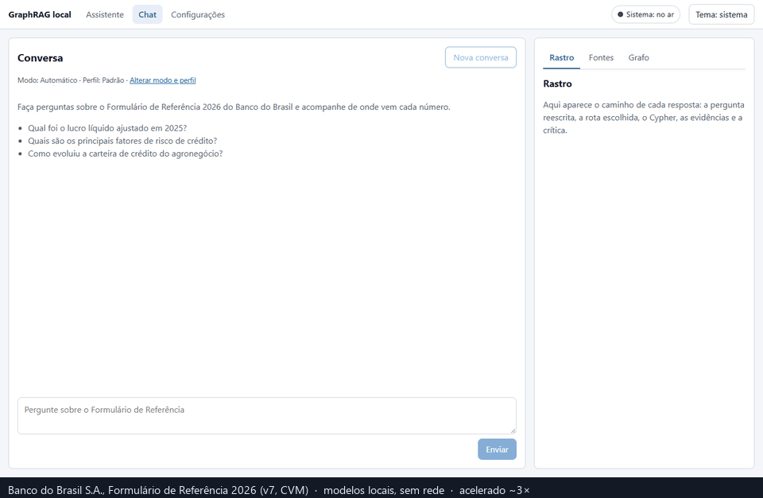
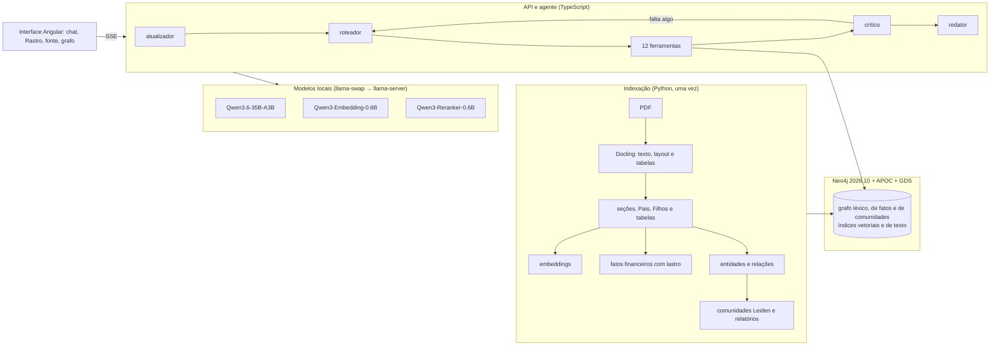

# GraphRAG local

Assistente que responde, **com a página citada**, perguntas sobre um documento financeiro de 423 páginas (o Formulário de Referência 2026 do Banco do Brasil), usando **somente modelos locais**: llama.cpp numa Radeon RX 9070 de 16 GB e 32 GB de RAM, um grafo no Neo4j e uma interface em Angular. Nenhuma chamada de rede sai da máquina na hora da consulta.

Baseado em *Essential GraphRAG* (Bratanič & Hane, Manning, 2025). Cada camada só entrou depois de medida contra a linha de base vetorial.



<sub>Trechos exibidos: Banco do Brasil S.A., *Formulário de Referência 2026*, versão 7, protocolado na CVM. O documento não está neste repositório (ver [ADR-009](docs/adr/ADR-009-documento.md)).</sub>

## O que a v1 entrega, em números

Versão congelada: tag [`v1.0.0`](../../releases/tag/v1.0.0). Golden set de 60 perguntas escritas sobre o documento (6 categorias), juiz local Gemma 4 26B-A4B, uma execução por degrau; diferença menor que 0,05 vale como empate. Tudo vem de [`eval/resultados/v1.md`](eval/resultados/v1.md), gerado por comando.

| Degrau | O que acrescenta | Correção | Página citada | Acerto numérico | Latência p50 / p95 |
|---|---|---:|---:|---:|---:|
| A0 | o LLM sozinho, de memória | 0,20 | 0,00 | 0,00 | 0,4 / 10,8 s |
| A1 | busca vetorial ingênua | 0,54 | 0,44 | 0,24 | 2,3 / 7,1 s |
| A2 | + texto completo (híbrido RRF) | 0,53 | 0,47 | 0,24 | 2,4 / 8,4 s |
| A3 | + documento-pai e reranker | 0,54 | 0,47 | 0,24 | 5,0 / 10,5 s |
| A3ts | o mesmo A3 pelo pipeline do agente (controle) | 0,57 | 0,53 | 0,29 | 9,4 / 20,7 s |
| A4 | + fatos no grafo, templates Cypher e Text2Cypher | 0,61 | 0,58 | 0,38 | 10,3 / 23,6 s |
| A5 | + busca local e global (comunidades) | 0,58 | 0,58 | 0,38 | 10,5 / 46,8 s |
| **A6** | **agente completo: 12 ferramentas e crítico** | **0,87** | **0,89** | **0,86** | 17,4 / 70,1 s |

Em 24 perguntas novas, escritas depois e nunca usadas para ajustar nada: A3 0,48 → A6 **0,77**.

**O que os números dizem:** de A1 a A5 tudo empata; ter o documento é o que importa, e o grafo sozinho não muda a nota. O salto do A6 vem do **ciclo do agente**: o crítico lê a evidência inteira e pede mais busca quando falta o valor, e as tabelas do documento entram junto de toda pergunta roteada. É ele que leva a agregação de 0,00 a 0,70 e a numérica de 0,47 a 0,90 ([ADR-081](docs/adr/ADR-081-correcao-das-falhas-do-agente.md), [ADR-082](docs/adr/ADR-082-congelamento-da-v1.md)).

### Metas da v1 (ARQUITETURA §1.3)

| Meta | Resultado |
|---|---|
| Privacidade: nada sai da máquina na consulta | **atingida**: 0 conexões externas em 448 amostras; nenhuma URL externa no caminho da consulta |
| Fidelidade ≥ 0,90 | **atingida**: 0,97 (60 perguntas) e 1,00 (24 novas) |
| Correção ≥ 0,70 e +15 p.p. sobre o vetorial | **atingida**: 0,87 contra 0,54 (+33 p.p.); 0,77 contra 0,48 nas novas |
| Busca global ≤ 90 s, com progresso | **atingida**: 10 de 10, a pior com 85,7 s |
| Versões e prompts fixados no lock | **atingida**: modelos e 22 arquivos de prompt com SHA-256 em `infra/models.lock.json` |
| Pergunta simples: 1º token ≤ 5 s e resposta ≤ 20 s | **não atingida**: 1º token em 14,6 s e resposta em 15,5 s (medianas); 24 de 30 terminam em ≤ 20 s |
| 100% das afirmações numéricas com página | **não atingida** nas 60 (92,06%; as 5 frases sem citação são rótulos de uma lista numerada); 100% nas 24 |
| VRAM ≤ 15,2 GB e RAM ≤ 28 GB | VRAM **ok** (11,5 GB); RAM do sistema inteiro **31,6 GB**, com o Windows e os aplicativos abertos |

Os desvios estão explicados no [ADR-082](docs/adr/ADR-082-congelamento-da-v1.md). O principal: o redator só escreve depois que o ciclo de busca termina, e cada passo é uma chamada a um modelo de 35B parcialmente na RAM.

## Como funciona



- **Indexação** (`indexer/`, Python): o Docling converte o PDF preservando página e tabelas; o texto vira seções, Pais (~1.200 tokens) e Filhos (~320); o LLM extrai fatos financeiros (só entram os que têm o valor na evidência), entidades e relações, que são resolvidas, resumidas e agrupadas em comunidades Leiden com relatórios.
- **Consulta** (`api/`, TypeScript): o agente reescreve a pergunta, escolhe as ferramentas (trechos, tabelas, fatos, séries, Text2Cypher com guarda-corpos, busca local por entidade, busca global por comunidades), o crítico decide se a evidência basta (até 2 rodadas) e o redator responde em português com a página de cada afirmação. Tudo sai por SSE, passo a passo.
- **Interface** (`web/`, Angular 22): chat com streaming, o **Rastro** (rota, Cypher, evidências e crítica), o PDF aberto na página citada e o subgrafo usado.

Detalhes: [`docs/ARQUITETURA.md`](docs/ARQUITETURA.md); cada decisão tem um ADR em [`docs/adr/`](docs/adr).

## Requisitos

| | |
|---|---|
| Sistema | Windows 10 ou 11 (x64), PowerShell 5.1 (o que vem com o Windows) |
| GPU | AMD com Vulkan e 16 GB de VRAM (medido numa RX 9070); driver AMD atualizado |
| RAM | 32 GB (o LLM principal deixa parte dos *experts* na RAM) |
| Disco | ~30 GB para os modelos obrigatórios (em `C:\modelos`) + ~3 GB para o projeto |
| Programas | [Git](https://git-scm.com/download/win) e [Python 3.12](https://www.python.org/downloads/) (marque "Add python.exe to PATH"). O resto (Node, uv, llama.cpp, llama-swap, Java, Neo4j) é baixado pelo instalador para dentro de `infra\bin`, sem mexer no sistema |
| Tempo | ~1 h para instalar (com os ~24 GB de modelos), ~12 min para ler o PDF e **8 a 9 h para indexar** o documento (uma vez) |

## Subir do zero

Todos os comandos são do PowerShell, a partir da pasta do projeto. Para os scripts `.ps1` rodarem nesta janela:

```powershell
Set-ExecutionPolicy -Scope Process -ExecutionPolicy Bypass
```

**1. Clonar**

```powershell
git clone https://github.com/Rafaalex21/graph-rag.git
cd graph-rag
```

**2. Instalar** (baixa e confere pelo SHA-256 cada arquivo listado em `infra\models.lock.json`; repetir só refaz o que falta)

```powershell
.\infra\instalar.ps1
```

Os modelos GGUF vão para `C:\modelos`. Se você já os tiver lá, o instalador confere o tamanho e o hash e não baixa de novo. Para usar outra pasta, mude `dir_modelos` em `infra\models.lock.json` e a macro `modelos` em `infra\llama-swap.yaml`. O instalador também cria o `.env` com uma senha gerada para o Neo4j (o `.env` não vai para o git).

**3. O documento.** A v1 indexou a **versão 7** do Formulário de Referência 2026 do Banco do Brasil (de 21/09/2026, 423 páginas, SHA-256 `B0D175661531FDD672A0DB7ABD44931CB43B05A122264A33CBE9E6186E3432B4`). O documento não é redistribuído aqui, e o site de Relações com Investidores do BB passou a entregar, no mesmo link, uma versão mais nova (de 11/11/2026).

- **Se você tem o arquivo da versão 7**, copie-o para `data\raw\banco_do_brasil_formulario_referencia_2026.pdf` e confira o hash:

  ```powershell
  New-Item -ItemType Directory -Force data\raw | Out-Null
  Copy-Item <onde-está-o-seu-pdf> data\raw\banco_do_brasil_formulario_referencia_2026.pdf
  (Get-FileHash data\raw\banco_do_brasil_formulario_referencia_2026.pdf).Hash
  ```

- **Se não tem**, baixe a versão atual do site de RI para o mesmo nome. Tudo funciona igual, mas o índice sai parecido, não igual: os números deste README, as páginas do golden set e as 60 perguntas valem para a versão 7, e o grafo continuará chamando o documento de "v7".

  ```powershell
  New-Item -ItemType Directory -Force data\raw | Out-Null
  curl.exe -L -o data\raw\banco_do_brasil_formulario_referencia_2026.pdf "https://api.mziq.com/mzfilemanager/v2/d/5760dff3-15e1-4962-9e81-322a0b3d0bbd/8ddd4264-6e9d-e147-24c6-8941de61c467?origin=2"
  ```

**4. Subir o Neo4j e os modelos** (o llama-swap fica numa janela própria; feche-a para parar)

```powershell
.\infra\neo4j.ps1 iniciar
Start-Process powershell -ArgumentList "-NoExit", "-ExecutionPolicy", "Bypass", "-File", "infra\swap.ps1"
```

Espere uns segundos e confira: `curl.exe -s http://127.0.0.1:8080/v1/models` lista os modelos.

**5. Ler o PDF** (Docling na CPU, ~12 min) e montar seções e trechos:

```powershell
. .\infra\dev-env.ps1
cd indexer
uv run --group parse python -m indexer.parse ..\data\raw\banco_do_brasil_formulario_referencia_2026.pdf --artefatos ..\infra\bin\modelos-docling --saida ..\data\parsed
uv run python -m indexer.normalize ..\data\parsed\banco_do_brasil_formulario_referencia_2026.docling.json --saida ..\data\parsed
uv run --group parse python -m indexer.sections ..\data\parsed\banco_do_brasil_formulario_referencia_2026.normalizado.json --pdf-original ..\data\raw\banco_do_brasil_formulario_referencia_2026.pdf --saida ..\data\parsed
uv run python -m indexer.chunks ..\data\parsed\banco_do_brasil_formulario_referencia_2026.normalizado.json ..\data\parsed\banco_do_brasil_formulario_referencia_2026.secoes.json --saida ..\data\parsed
cd ..
```

**6. Indexar** (8 a 9 h com a GPU ocupada; deixe rodando, de preferência à noite):

```powershell
.\infra\indexar-documento.ps1
```

O andamento fica em `data\logs\f58_estado.txt` (uma linha) e `data\logs\f58_etapas.log`. Se parar no meio (queda, PC desligado), rode de novo com `-De <etapa>` a partir da etapa que falhou: as chamadas ao LLM ficam em cache e não se repetem. Termina com a linha `pronto`.

**7. Subir a API e a interface**, cada uma na sua janela:

```powershell
Start-Process powershell -ArgumentList "-NoExit", "-ExecutionPolicy", "Bypass", "-Command", ". .\infra\dev-env.ps1; cd api; npm run build; npm start"
Start-Process powershell -ArgumentList "-NoExit", "-ExecutionPolicy", "Bypass", "-Command", ". .\infra\dev-env.ps1; cd web; npm start"
```

Abra **http://localhost:4200** e pergunte, por exemplo: *"Quem é o acionista controlador do Banco do Brasil e qual percentual do capital ele detém?"* A primeira resposta demora mais (o modelo de 22 GB é carregado na primeira pergunta).

Conferir sem navegador:

```powershell
curl.exe -s http://127.0.0.1:3000/api/saude
```

**Para parar:** feche as janelas da API, da interface e do llama-swap, e rode `.\infra\neo4j.ps1 parar`.

## Reproduzir os números

Com o Neo4j e o llama-swap no ar e o instalador rodado com `-ComOpcionais -ComHip` (o juiz Gemma usa o build HIP):

```powershell
.\infra\rodar-f95.ps1 -Fase metas      # metas da §1.3 (~1 h)
.\infra\rodar-f95.ps1 -Fase escada     # degraus A3ts, A4 e A5 com o juiz (~3 h 40)
.\infra\rodar-f95.ps1 -Fase tabela     # regera eval\resultados\v1.md
```

Os degraus A0 a A3 e o A6 têm os comandos em [`eval/f91-medida-ablacao.md`](eval/f91-medida-ablacao.md) e em [`eval/f94-medida-correcao.md`](eval/f94-medida-correcao.md). Toda medida deste projeto foi escrita e commitada **antes** de rodar, com a regra de aceite, e toda execução fica contada, inclusive as que falharam.

## Onde está o quê

```
docs/        especificação (ARQUITETURA), plano (ETAPAS, 83 tarefas) e 82 ADRs
infra/       instalador, lock de versões, llama-swap, Neo4j, roteiros de indexação e de medida
contracts/   esquemas da extração e contrato da API (OpenAPI com os eventos SSE)
indexer/     Python: parsing, extração, grafo, embeddings, comunidades, avaliação
api/         TypeScript: agente, ferramentas, SSE
web/         Angular 22: interface do assistente
e2e/         testes E2E com Playwright (não há testes unitários, ADR-068)
eval/        golden set, medidas pré-registradas e resultados
data/        documento e artefatos (fora do git)
tools/       automação do plano e das issues do GitHub
```

O plano vive em [`docs/ETAPAS.md`](docs/ETAPAS.md): cada tarefa tem critério de aceite e só vira `[x]` quando ele foi verificado. O mesmo arquivo alimenta as issues e os marcos do GitHub (ação **ETAPAS**; localmente, `python tools/etapas.py check`).

## Licença e fonte

[MIT](LICENSE) para o código deste repositório. A licença não cobre o documento-fonte (Banco do Brasil S.A., Formulário de Referência 2026, v7, protocolado na CVM), que pertence ao emissor e fica fora do git; o README e o GIF mostram trechos curtos dele, com a fonte citada ([ADR-009](docs/adr/ADR-009-documento.md)).
