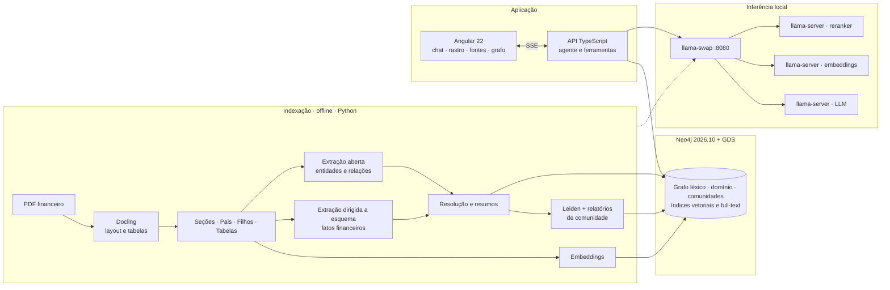
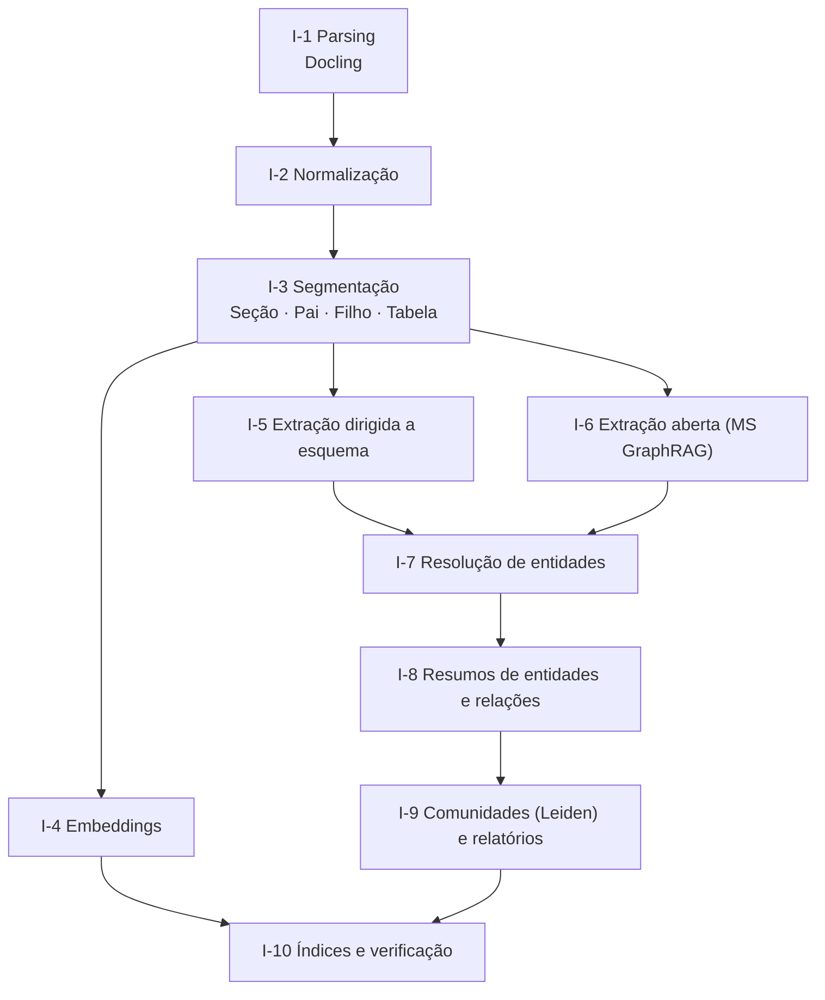
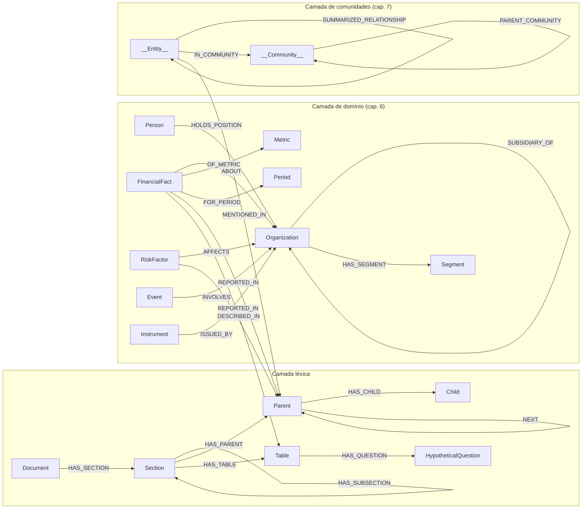
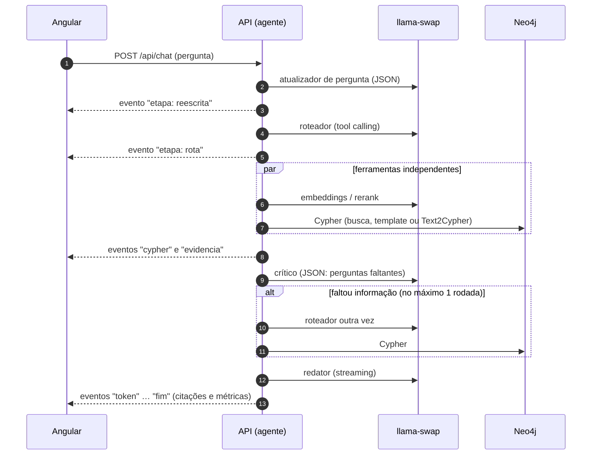

# GraphRAG Local — Especificação de Arquitetura

> **Projeto:** GraphRAG 100% local sobre um documento financeiro extenso, com assistente conversacional em Angular.
>
> **Base teórica:** *Essential GraphRAG* — Tomaž Bratanič & Oskar Hane (Manning, 2025).
>
> **Versão:** 0.5 · 28/10/2026 · **Status:** rascunho para validação — revisada com as medições da F0.4 a F0.6 e com o ambiente real na F0.7 ([ADR-001](./adr/ADR-001-backend.md), [ADR-010](./adr/ADR-010-offload-moe.md), [ADR-011](./adr/ADR-011-perfis-swap.md), [ADR-012](./adr/ADR-012-neo4j-nativo.md))
>
> **Documento irmão:** [`ETAPAS.md`](./ETAPAS.md) — plano executável, tarefa a tarefa, que alimenta o painel de acompanhamento.

---

## 0. Sumário executivo

**O quê.** Um assistente que responde perguntas sobre um documento financeiro grande (relatório anual, 10-K/20-F ou Formulário de Referência), combinando três famílias de recuperação que o livro ensina, cada uma boa naquilo em que as outras falham:

1. **Trechos** — busca vetorial e híbrida, com *parent-document* e reranking (caps. 2–3);
2. **Estrutura** — fatos financeiros extraídos para o grafo e consultados por templates Cypher ou Text2Cypher (caps. 4 e 6);
3. **Comunidades** — a camada do Microsoft GraphRAG, com resumos de entidades e relatórios de comunidade para perguntas locais e globais (cap. 7).

Um **agente** (cap. 5) escolhe a rota, executa as ferramentas, submete o resultado a um crítico e redige a resposta com citação de página. A **avaliação** (cap. 8) vem antes do grafo: cada camada só entra se provar, em números, o que acrescenta à linha de base vetorial.

**Onde.** Tudo local: Radeon RX 9070 (16 GB) + 32 GB de RAM, Windows. Modelos GGUF servidos pelo `llama-server` (llama.cpp, build Vulkan; o HIP fica só para o juiz da avaliação, por ora) atrás do `llama-swap`, que expõe uma API compatível com a da OpenAI. Grafo em Neo4j 2026.10 com APOC e GDS.

**Decisões-chave.**

| Tema | Decisão | Alternativa mantida em teste |
|---|---|---|
| Runtime de inferência | `llama-server` (build **Vulkan**, com `-lm none` no Qwen3.6) + `llama-swap` para perfis; build HIP só no juiz Gemma 4, provisório (ADR-001 revisada, ADR-010) | HIP também na indexação (+8% a +10% de prompt, −8% de geração; empate técnico) |
| LLM principal | **Qwen3.6-35B-A3B** (MoE, 3B ativos), experts parcialmente na RAM | gpt-oss-20b · Gemma 4 26B-A4B |
| Embeddings | **Qwen3-Embedding-0.6B** (1024 dims, multilíngue) | Qwen3-Embedding-4B · EmbeddingGemma 2 |
| Reranker | **Qwen3-Reranker-0.6B** | bge-reranker-v2-m3 |
| Parsing de PDF | **Docling** (layout + TableFormer) | Granite-Docling-258M |
| Banco | **Neo4j 2026.10** + APOC + GDS (Leiden) | — |
| Indexação | Python 3.12 (`uv`) | — |
| API e agente | Node LTS + TypeScript (Fastify), SSE | FastAPI |
| Interface | Angular 22 (standalone, signals) | — |
| Juiz da avaliação | Gemma 4 26B-A4B (família diferente do gerador) | Qwen3.6 com raciocínio ligado |

---

## 1. Objetivos, não-objetivos e requisitos

### 1.1 Objetivos

| ID | Objetivo | Exemplo de pergunta |
|---|---|---|
| O1 | Responder perguntas factuais com citação de página | "Quem é o auditor independente?" |
| O2 | Responder perguntas numéricas sem errar escala, sinal ou período | "Qual foi o EBITDA ajustado de 2025?" |
| O3 | Responder agregações e filtros sobre fatos estruturados | "Quais segmentos tiveram queda de receita?" |
| O4 | Responder perguntas temáticas que atravessam o documento | "Quais são os principais riscos do negócio?" |
| O5 | Expor o raciocínio: rota, Cypher gerado, trechos e subgrafo usados | painel "Rastro" na interface |
| O6 | Funcionar offline após o download dos modelos | — |
| O7 | Medir: cada camada justificada por métricas | tabela de ablação no README |

### 1.2 Não-objetivos da v1

- Vários documentos com atualização incremental contínua (o desenho permite; não é meta).
- Multiusuário, autenticação, implantação em nuvem.
- *Fine-tuning* de modelos (fica como extensão para Text2Cypher e embeddings).
- OCR de documentos escaneados (assume-se PDF nativo com camada de texto).

### 1.3 Requisitos não funcionais

| ID | Requisito | Meta |
|---|---|---|
| RNF-1 | Privacidade | Nenhuma chamada de rede externa em tempo de consulta |
| RNF-2 | Latência, pergunta simples | 1º token ≤ 5 s · resposta completa ≤ 20 s |
| RNF-3 | Latência, busca global | ≤ 90 s, com progresso transmitido |
| RNF-4 | Fidelidade (*faithfulness*) | ≥ 0,90 no golden set |
| RNF-5 | Correção (*answer correctness*) | ≥ 0,70 e ≥ +15 p.p. sobre a linha de base vetorial |
| RNF-6 | Rastreabilidade | 100% das afirmações numéricas com página de origem |
| RNF-7 | Reprodutibilidade | Versões de modelos, quantizações e prompts fixadas em `infra/models.lock.json` |
| RNF-8 | Orçamento de memória | Pico de VRAM ≤ 15,2 GB · pico de RAM ≤ 28 GB |

---

## 2. Restrições de hardware e orçamento de memória

### 2.1 Máquina-alvo

| Item | Valor | Implicação |
|---|---|---|
| GPU | Radeon RX 9070 · RDNA 4 (gfx1201) · 16 GB GDDR6 · ~640 GB/s | A geração de tokens é limitada pela banda de memória; modelos densos acima de ~14B em Q4 já apertam |
| RAM | 32 GB | Permite manter parte dos experts de um MoE fora da GPU |
| CPU | Ryzen 5 5600X (6 núcleos / 12 threads) | Expert na CPU custa velocidade; DDR4 dual-channel entrega ~40–50 GB/s |
| SO | Windows 11 | O Vulkan funciona direto com o driver; o HIP (usado só pelo juiz) exige as DLLs hipblas/rocblas, obtidas das wheels `rocm-sdk` num venv local (`infra/hip-env.ps1`) |

> A RX 9070 e a 9070 XT têm o mesmo barramento de 256 bits e a mesma banda; como a geração é limitada por banda, os números publicados para a XT servem de referência próxima (espere de 10 a 20% a menos no processamento de prompt, que depende de computação, não de banda).

### 2.2 Backend de GPU

- **Dois builds do llama.cpp (b11932), Vulkan e HIP; o Vulkan é o padrão.** Medido nesta máquina (F0.4 e F0.5): no Qwen3.6-35B-A3B com os experts na CPU, **carregar sem mmap (`-lm none`) multiplica o prompt por 2,4× a 3,1× e tira o pico de RAM de ~32,5 GB para 25,3 GB** (ADR-010); nessa condição o HIP processa prompt só ~8% a ~10% mais rápido e o Vulkan gera ~8% mais rápido (`ncmoe` 24 e 28). No gpt-oss-20b o Vulkan vence nos dois (~4× em prompt, +32% em geração). No Gemma 4 26B o HIP vence (+46% em prompt, +10% em geração), com a ressalva de pressão de VRAM do ADR-001. As estimativas de terceiros (Vulkan +12–18% em geração, ROCm ~+40% em prompt) valiam só em parte e, no caso do prompt, refletiam um carregamento com mmap.
- **Consequência prática:** a *indexação* é dominada pela **geração**, não pelo prompt: numa chamada de extração, ~2,5K tokens de entrada levam ~2,6 s e ~600 de saída levam ~17 s (cerca de 85% do tempo). Por isso a métrica decisiva é o `tg128`, onde o Vulkan ganha em todos os perfis do Qwen3.6. Decidido (ADR-001 revisada): **Vulkan em `indexar`, `consultar` e `consultar-rapido`; HIP só no juiz (`avaliar`), provisoriamente.** O mesmo processo do Qwen3.6 serve a indexação e a consulta (§9).
- **Por que não Ollama:** no Windows o suporte a AMD passa pelo Vulkan e não expõe o controle fino de *offload* de experts (`--n-cpu-moe`), de que este projeto depende. LM Studio fica como bancada visual de testes.
- **Por que não vLLM:** no Windows só roda em contêiner Linux, e o suporte a gfx1201 vinha incompleto.

### 2.3 Regra de encaixe

Para cada perfil de execução:

```
VRAM:  Σ pesos na GPU + KV cache + buffers de computação + desktop (3,5 a 4,5 GB medidos aqui) ≤ 16 GB
RAM:   Σ experts na CPU + Windows (~7 GB) + Neo4j (~2 GB: heap de 1 GB, page cache de 512 MB e a JVM) + apps e navegador (~3 GB) ≤ 30 GB
```

O desktop é a parcela mais subestimada: a F0.4 mediu 3,5 a 4,5 GB de VRAM em uso **antes** de qualquer modelo (Firefox, SignalRGB, app do Claude e o Windows), contra os ~0,8 GB supostos na v0.1. O orçamento deve ser feito com o valor medido, e o pico do RNF-8 (≤ 15,2 GB) é o total do adaptador (contador `GPU Adapter Memory`, desktop incluído). Fechar aplicativos pesados antes de indexar ou avaliar devolve parte desse espaço.

O botão de ajuste é o `--n-cpu-moe N` do llama.cpp: quantas camadas de experts do MoE ficam na CPU. Cada camada movida libera VRAM e custa alguma velocidade.

### 2.4 Orçamento por perfil (medido na F0.4 e F0.5; o que é estimativa está marcado)

| Perfil | Modelos residentes | VRAM (adaptador, desktop incluído) | RAM do servidor |
|---|---|---|---|
| `indexar` | Qwen3.6-35B-A3B UD-Q4_K_XL (22,4 GB), `--n-cpu-moe 28 -lm none` · ctx 2×16K | 12,4 GB *(medido)* | ~14,5 GB *(medido)* |
| `vetorizar` | Qwen3-Embedding-0.6B Q8_0 em lote (LLM descarregado) | ~2 GB | — |
| `consultar` *(padrão)* | Qwen3.6-35B-A3B (igual ao `indexar`) + Reranker-0.6B (`-c 4096`) na GPU + Embedding-0.6B na CPU | 13,6 GB *(medido na F0.6, em regime)* | ~25 GB do sistema *(medido; 25,3 GB com ~15K de contexto na F0.5)* |
| `consultar-rapido` | gpt-oss-20b MXFP4 com `--n-cpu-moe 4 -lm none` (~75 tok/s) + Reranker-0.6B na GPU + Embedding-0.6B na CPU | 14,8 GB *(medido; inteiro na GPU o gpt-oss sozinho chega a 15,1 GB)* | ~14 GB do sistema *(medido)* |
| `avaliar` | Juiz Gemma 4 26B-A4B QAT Q4_0 (14,4 GB), build HIP | 15,9 a 16,0 GB *(medido; no teto da placa, reconfirmar com o desktop leve)* | — |

Medido na F0.5 (Vulkan, `-c 32768 -np 2`, dois prompts de ~15K tokens, pico do sistema inteiro): Qwen3.6-35B-A3B com `-lm none` e `--n-cpu-moe 24` → VRAM 14,2 GB e RAM 23,5 GB; com `--n-cpu-moe 28` → VRAM 12,4 GB e RAM 25,3 GB. Com o mmap padrão, a RAM chegava a ~32,5 GB. O `ncmoe 24` rende ~8% a mais de geração, mas deixa só ~1 GB de folga de VRAM com o desktop em 3,5 GB (e menos com o desktop maior), por isso o padrão é 28. O cache `--moe-cache-mib` não compensou (ADR-010).

Tamanhos de arquivo não são consumo em execução: KV cache e buffers somam de 0,5 a 2 GB conforme o contexto. Embutir uma pergunta na CPU custa milissegundos; reranquear na CPU, não — por isso o reranker fica na GPU.

---

## 3. Do livro à arquitetura

| Cap. | Técnica do livro | Componente deste projeto | Adaptação |
|---|---|---|---|
| 1 | Grafo que une dado estruturado e não estruturado | Modelo de grafo em três camadas (§6) | Léxica + domínio + comunidades no mesmo banco |
| 2 | Busca vetorial; híbrida com full-text e normalização pelo máximo | Ferramenta `buscar_trechos` | Normalização pelo máximo (como no livro) e RRF como variante. O ganho do híbrido é hipótese a medir: num estudo recente com FinanceBench, a fusão híbrida não superou a busca densa |
| 3 | Step-back, *parent-document*, perguntas hipotéticas; reranking e filtros (quadro lateral) | Reescrita da consulta; nós Pai/Filho; perguntas hipotéticas para tabelas; reranker | Pai alinhado a seção e página; Qwen3-Reranker sobre k×4 filhos deduplicados |
| 4 | Text2Cypher com esquema, *few-shot*, mapeamento terminológico e instruções de formato | Ferramenta `consultar_grafo` | Sessão somente-leitura, `EXPLAIN`, `LIMIT`, uma autocorreção; mapeamento PT↔EN de métricas |
| 5 | Agente: roteador, ferramentas, atualizador de pergunta, crítico | Orquestrador em TypeScript | *Tool calling* nativo do `llama-server`; crítico com uma rodada extra; ferramenta `resposta_ja_dada` |
| 6 | Extração estruturada (Pydantic), importação, *constraints*, resolução de entidades | Indexador, etapa F4 | JSON Schema imposto por gramática no `llama-server`; lastro numérico obrigatório; IDs determinísticos (o livro alerta para o `randomUUID()` não idempotente) |
| 7 | MS GraphRAG: extração com *gleaning*, resumos, comunidades, busca local e global | Indexador F5 + ferramentas `entidade` e `panorama` | Leiden hierárquico no GDS; tratamento do supernó (o emissor); saída em JSON em vez de tuplas delimitadas |
| 8 | Benchmark com Cypher como gabarito; recall de contexto, fidelidade, correção | Pasta `eval/` | Juiz local de outra família; métricas por rota e de latência; escada de ablações |
| Ap. A | Neo4j + APOC + GDS | `infra/neo4j.ps1` | Versão 2026.10, nativo no Windows (ADR-012); memória limitada para caber ao lado dos modelos |

---

## 4. Visão geral



| Componente | Responsabilidade | Tecnologia |
|---|---|---|
| `indexer/` | Parsing, segmentação, embeddings, extração, resolução, resumos, comunidades | Python 3.12, Docling, Pydantic v2, driver Neo4j, SDK OpenAI |
| `api/` | Agente, ferramentas de recuperação, SSE, telemetria | Node LTS, TypeScript, Fastify, `neo4j-driver`, SDK OpenAI, Zod |
| `web/` | Chat, rastro, visualizador de fonte, explorador de grafo | Angular 22, pdf.js, NVL ou Cytoscape.js |
| `eval/` | Golden set, métricas, ablações, bake-offs | Python, pandas, RAGAS (opcional) |
| `infra/` | llama-swap, scripts do Neo4j nativo, *lock* de modelos, scripts | YAML, PowerShell |
| `contracts/` | Esquema do grafo e da API — a fronteira entre Python e TypeScript | Cypher, JSON Schema, OpenAPI |

---

## 5. Pipeline de indexação

Cada etapa grava sua saída em disco (`data/<etapa>/`) com chave por *hash* de conteúdo e de prompt. Toda chamada a LLM passa por um cache (SQLite) indexado por `(modelo, quantização, hash do prompt, parâmetros)`: uma reexecução após falha recomeça de onde parou, e mudar um único prompt reprocessa só o que dele depende.



### I-1 · Parsing (Docling)

- **Entrada:** PDF nativo. **Saída:** `DoclingDocument` em JSON + Markdown por página.
- Layout e ordem de leitura; tabelas com TableFormer em modo *accurate*; títulos com nível; número de página em cada elemento.
- OCR desligado (assume camada de texto). Fallback para tabelas difíceis: pipeline VLM com Granite-Docling-258M.
- Roda na CPU — o PyTorch em CPU basta e não disputa a GPU com o LLM.

### I-2 · Normalização

- Remoção de cabeçalhos e rodapés repetidos (linhas presentes em mais de 30% das páginas).
- Associação de notas de rodapé ao parágrafo de origem.
- **Normalizador numérico** (módulo próprio, com testes): separadores pt-BR (`1.234,56`) e EN (`1,234.56`), negativos entre parênteses `(1.234)`, escala declarada no cabeçalho da tabela ("em milhares de reais", "in millions of US$"), percentuais e pontos-base. É o ponto onde documentos financeiros mais enganam um RAG.

### I-3 · Segmentação (caps. 2 e 3)

| Unidade | Tamanho inicial | Regra | Uso |
|---|---|---|---|
| **Seção** | variável | Árvore de títulos do Docling (ex.: *Item 1A Risk Factors*, *4. Fatores de Risco*) | Navegação, filtro, contexto |
| **Pai** (*parent*) | ≈ 1.200 tokens (máx. 1.600) | Nunca atravessa seção; guarda `pageStart`/`pageEnd` | Unidade de extração e de contexto para o LLM |
| **Filho** (*child*) | ≈ 320 tokens, sobreposição de 12% | Prefixado com o caminho da seção ("Fatores de Risco › Câmbio") | Unidade de embedding e full-text |
| **Tabela** | atômica | Markdown integral + legenda + página | Fonte de fatos numéricos e de citação |
| **Pergunta hipotética** | 3–5 por tabela | Geradas pelo LLM (estratégia do cap. 3) | Embedding que representa a tabela na busca |

Tokens contados com o tokenizador do próprio modelo (endpoint `/tokenize` do `llama-server`), não com `tiktoken`. A escolha de ~1.200 tokens para o Pai segue o achado do MS GraphRAG (cap. 7, fig. 7.2): trechos menores rendem mais entidades extraídas, e algo entre 600 e 1.200 tokens equilibra rendimento e custo.

### I-4 · Embeddings

- **Modelo:** Qwen3-Embedding-0.6B, 1024 dimensões, vetores normalizados, similaridade de cosseno.
- **Assimetria consulta/documento:** documentos sem instrução; consultas com o prefixo `Instruct: <tarefa>\nQuery: <pergunta>`, em inglês, como recomenda o modelo — mesmo para perguntas em português.
- **O que se embute:** Filhos, perguntas hipotéticas das tabelas, resumos de entidade (após I-8) e relatórios de comunidade (após I-9).
- Trocar de modelo de embedding obriga a recriar os índices vetoriais (cap. 2); por isso a dimensão fica registrada no *lock*.

### I-5 · Extração dirigida a esquema (cap. 6)

Modelos Pydantic com descrição em cada campo e `Optional` em tudo que pode faltar — o livro observa que campos obrigatórios sem informação induzem o modelo a inventar valores. O JSON Schema gerado vai em `response_format: {type: "json_schema"}` e o `llama-server` o impõe por gramática: a saída é JSON válido por construção.

```python
class FinancialFact(BaseModel):
    """Um valor numérico reportado no documento, com período e evidência."""
    metric: str = Field(..., description="Nome da métrica como aparece no texto, ex.: 'Receita líquida', 'Adjusted EBITDA'")
    value: float = Field(..., description="Valor já com sinal; negativos entre parênteses viram negativos")
    unit: Literal["currency", "percent", "count", "ratio", "basis_points"]
    currency: Optional[str] = Field(None, description="ISO 4217, ex.: BRL, USD")
    scale: Literal[1, 1_000, 1_000_000, 1_000_000_000] = Field(..., description="Escala declarada na tabela ou no texto")
    period: str = Field(..., description="Formato canônico: 2025-FY, 2025-Q4 ou 2025-12-31")
    period_type: Literal["fiscal_year", "quarter", "point_in_time"]
    entity: str = Field(..., description="Empresa ou segmento a que o valor se refere")
    segment: Optional[str] = None
    evidence: str = Field(..., description="Trecho literal curto (≤ 200 caracteres) que contém o valor")
```

Demais esquemas: `Organization` (com papel na relação: emissor, subsidiária, controlada, coligada, auditor, regulador, contraparte), `Person` + cargo, `Segment`, `RiskFactor` (categoria em *enum*: mercado, crédito, liquidez, operacional, regulatório, câmbio, ESG, outro), `Event` (aquisição, desinvestimento, emissão, litígio, reestruturação, dividendos) e `Instrument` (debênture, *bond*, empréstimo, derivativo).

**Guardas:**

1. **Lastro numérico** — um fato só é aceito se o valor, normalizado, aparece no trecho `evidence`, e se `evidence` existe no texto do Pai ou da Tabela. Fato sem lastro é descartado e registrado.
2. **Validação Pydantic** + uma retentativa com a mensagem de erro anexada.
3. **IDs determinísticos** (hash de documento + página + métrica + período + entidade): reimportar não duplica nada.

### I-6 · Extração aberta (MS GraphRAG, cap. 7)

- **Tipos de entidade** (definidos antes, como o livro exige): `ORGANIZATION`, `PERSON`, `SEGMENT`, `PRODUCT_OR_SERVICE`, `FINANCIAL_METRIC`, `RISK`, `EVENT`, `FINANCIAL_INSTRUMENT`, `REGULATION`, `LOCATION`.
- **Saída em JSON** — `{entities: [{name, type, description}], relationships: [{source, target, description, strength 1–10}]}` — em vez das tuplas com delimitadores do artigo original: com gramática, modelos locais erram muito menos de formato.
- ***Gleaning*** (passadas extras de "faltaram entidades?"): configurável, 0 ou 1. O livro mostra que cada passada acha mais entidades; aqui ela dobra o custo, então a F5 mede o ganho em 20 Pais antes de ligar no corpus inteiro.
- Cada entidade liga-se ao Pai de onde saiu: `(:__Entity__)-[:MENTIONED_IN]->(:Parent)`.
- Prompts no idioma do documento; nomes canônicos de entidade preservados como aparecem.

### I-7 · Resolução de entidades (cap. 6.2.2)

1. Normalização: caixa, acentos, sufixos societários (S.A., Ltda., Inc., Corp., Ltd., Limited).
2. Bloqueio por tipo e primeiro token significativo.
3. Candidatos por similaridade de embedding de `nome + descrição` (limiar inicial 0,92).
4. Confirmação por LLM (sim/não com justificativa curta) para os pares candidatos.
5. Fusão com `apoc.refactor.mergeNodes`, preservando `aliases`.
6. Chaves fortes quando existirem (ticker, CNPJ) vencem qualquer heurística.

### I-8 · Resumos de entidades e relações (cap. 7.2.3)

- Entidades e pares de entidades com mais de uma descrição recebem resumo único (prompt do artigo, adaptado ao idioma).
- **Supernó:** num documento de uma só empresa, o emissor aparece em quase todo trecho — exatamente o caso de "Atenas" que o livro descreve. Tratamento: o emissor recebe o rótulo `:Issuer`; suas descrições são ranqueadas por diversidade de seção e resumidas em dois níveis (lotes de 30 → resumo dos resumos).
- Saída: `__Entity__.summary` e `(:__Entity__)-[:SUMMARIZED_RELATIONSHIP {summary, weight, rank}]->(:__Entity__)`.

### I-9 · Comunidades e relatórios (cap. 7.2.4)

- **Leiden hierárquico** no GDS (o artigo original usa Leiden; o livro usa Louvain por simplicidade), com `includeIntermediateCommunities: true` para obter níveis.
- Projeção: `__Entity__` + `SUMMARIZED_RELATIONSHIP` com peso = força, **excluindo o emissor**, para que as comunidades se formem em torno de temas e não colapsem num único astro.
- Nós `(:__Community__ {id, level, title, summary, rating, rank})` ligados por `IN_COMMUNITY` e `PARENT_COMMUNITY`.
- Relatório por comunidade em JSON: título, resumo, impacto (0–10), explicação do impacto, 5–10 achados com referências.
- Comunidades grandes demais para o contexto: ranqueamento de entidades e relações antes do prompt (o livro antecipa o problema).
- Relatórios embutidos em `community_vec`.

### I-10 · Índices e verificação

Criação dos índices da §6.3; consultas de sanidade (§6.4); *dump* do banco com `neo4j-admin database dump` como ponto de restauração.

### 5.1 Parâmetros iniciais

| Parâmetro | Valor inicial | Onde se calibra |
|---|---|---|
| Pai / Filho | 1.200 / 320 tokens, sobreposição 12% | F2 e F9 |
| k de filhos antes da deduplicação | k × 4 (como no cap. 3) | F2 |
| Pais enviados ao reranker / ao LLM | 24 / 6 | F2 e F9 |
| Temperatura de extração | 0,2–0,3, sem raciocínio | F4 |
| *Gleaning* | 0 (decidido por medição) | F5 |
| Limiar de similaridade na resolução | 0,92 | F4 |
| Limiar de *rating* na busca global | 5 (como no cap. 7) | F6 |
| Slots paralelos no `llama-server` | 2 | F0 |

### 5.2 Estimativa de tempo de indexação

Hipóteses: documento de ~300 páginas (~200 mil tokens) → ~170 Pais e ~40 tabelas. Throughput medido na F0.4 sem mmap (Qwen3.6-35B-A3B no Vulkan, `--n-cpu-moe 28 -lm none`, profundidade 0): 957 tok/s de processamento de prompt (`pp2048`) e 35,4 tok/s de geração. É um limite inferior do tempo: ignora o custo da gramática JSON, o *decode* mais lento com contexto longo e a interferência entre os 2 slots (a F0.5 mediu a geração de um slot caindo a ~10 tok/s enquanto o outro processa um prompt de 15K).

| Etapa | Chamadas | Custo por chamada | Total |
|---|---|---|---|
| Extração dirigida a esquema | ~210 | ~2,5K entrada / 0,6K saída | ~1,1 h |
| Extração aberta (sem *gleaning*) | ~170 | ~3K / 1K | ~1,5 h |
| Perguntas hipotéticas das tabelas | ~40 | ~2K / 0,3K | ~7 min |
| Resumos de entidades e relações | ~600 | ~1K / 0,2K | ~1,1 h |
| Relatórios de comunidade | ~80 | ~6K / 1K | ~46 min |
| **Total** | | | **~4,6 h — uma noite** |

Com gpt-oss-20b no Vulkan (4.402 tok/s de prompt e 170 tok/s de geração medidos) o mesmo cálculo dá cerca de 1 h inteiro na GPU (cerca de 2 h com o `--n-cpu-moe 4` do perfil rápido); o bake-off da F9 dirá se a qualidade acompanha. Antes do documento inteiro, todo o ciclo F1–F5 roda num recorte de até 80 páginas.

---

## 6. Modelo de grafo

Identificadores do grafo em inglês (ADR-006): os modelos de Text2Cypher, inclusive os ajustados pela Neo4j, foram treinados sobre esquemas em inglês. A interface e as respostas são em português; o mapeamento terminológico faz a ponte.

### 6.1 Camadas



Todo nó de domínio (`Organization`, `Person`, `Segment`, `RiskFactor`, `Event`, `Instrument`, `Metric`) recebe também o rótulo `__Entity__` com a propriedade `type`. Assim, a extração aberta (I-6) e a dirigida (I-5) convergem nos mesmos nós depois da resolução, e a busca local alcança os fatos estruturados.

### 6.2 Propriedades principais

| Rótulo | Propriedades |
|---|---|
| `Document` | `id`, `title`, `issuer`, `fiscalYear`, `language`, `sourceFile`, `pages` |
| `Section` | `id`, `title`, `level`, `path`, `pageStart`, `pageEnd` |
| `Parent` | `id`, `text`, `tokens`, `pageStart`, `pageEnd` |
| `Child` | `id`, `text`, `page`, `embedding` |
| `Table` | `id`, `caption`, `markdown`, `page`, `description`, `scale`, `currency` |
| `FinancialFact` | `id`, `metric`, `value`, `unit`, `currency`, `scale`, `period`, `periodType`, `evidence`, `page` |
| `Metric` | `name` (canônico), `aliases`, `definition` |
| `Period` | `id` (ex.: `2025-FY`, `2025-Q4`), `start`, `end` |
| `__Entity__` | `id`, `name`, `type`, `aliases`, `description` (lista), `summary`, `embedding` |
| `__Community__` | `id`, `level`, `title`, `summary`, `rating`, `rank`, `embedding` |

### 6.3 *Constraints* e índices

```cypher
// Unicidade
CREATE CONSTRAINT document_id IF NOT EXISTS FOR (n:Document) REQUIRE n.id IS UNIQUE;
CREATE CONSTRAINT section_id  IF NOT EXISTS FOR (n:Section)  REQUIRE n.id IS UNIQUE;
CREATE CONSTRAINT parent_id   IF NOT EXISTS FOR (n:Parent)   REQUIRE n.id IS UNIQUE;
CREATE CONSTRAINT child_id    IF NOT EXISTS FOR (n:Child)    REQUIRE n.id IS UNIQUE;
CREATE CONSTRAINT table_id    IF NOT EXISTS FOR (n:Table)    REQUIRE n.id IS UNIQUE;
CREATE CONSTRAINT fact_id     IF NOT EXISTS FOR (n:FinancialFact) REQUIRE n.id IS UNIQUE;
CREATE CONSTRAINT metric_name IF NOT EXISTS FOR (n:Metric)   REQUIRE n.name IS UNIQUE;
CREATE CONSTRAINT period_id   IF NOT EXISTS FOR (n:Period)   REQUIRE n.id IS UNIQUE;
CREATE CONSTRAINT entity_id   IF NOT EXISTS FOR (n:__Entity__)    REQUIRE n.id IS UNIQUE;
CREATE CONSTRAINT community_id IF NOT EXISTS FOR (n:__Community__) REQUIRE n.id IS UNIQUE;

// Vetoriais (1024 dims = Qwen3-Embedding-0.6B)
CREATE VECTOR INDEX child_vec IF NOT EXISTS FOR (n:Child) ON n.embedding
  OPTIONS {indexConfig: {`vector.dimensions`: 1024, `vector.similarity_function`: 'cosine'}};
CREATE VECTOR INDEX question_vec IF NOT EXISTS FOR (n:HypotheticalQuestion) ON n.embedding
  OPTIONS {indexConfig: {`vector.dimensions`: 1024, `vector.similarity_function`: 'cosine'}};
CREATE VECTOR INDEX entity_vec IF NOT EXISTS FOR (n:__Entity__) ON n.embedding
  OPTIONS {indexConfig: {`vector.dimensions`: 1024, `vector.similarity_function`: 'cosine'}};
CREATE VECTOR INDEX community_vec IF NOT EXISTS FOR (n:__Community__) ON n.embedding
  OPTIONS {indexConfig: {`vector.dimensions`: 1024, `vector.similarity_function`: 'cosine'}};

// Full-text (analisador conforme o idioma do documento: 'brazilian' ou 'english')
CREATE FULLTEXT INDEX child_ft IF NOT EXISTS FOR (n:Child) ON EACH [n.text]
  OPTIONS {indexConfig: {`fulltext.analyzer`: 'brazilian'}};
CREATE FULLTEXT INDEX entity_ft IF NOT EXISTS FOR (n:__Entity__) ON EACH [n.name, n.aliasesText];

// Consultas estruturadas
CREATE INDEX fact_metric_period IF NOT EXISTS FOR (n:FinancialFact) ON (n.metric, n.period);
```

### 6.4 Consultas de sanidade

```cypher
// Filhos órfãos (deve ser 0)
MATCH (c:Child) WHERE NOT (c)<-[:HAS_CHILD]-(:Parent) RETURN count(c);
// Fatos sem evidência ligada (deve ser 0)
MATCH (f:FinancialFact) WHERE NOT (f)-[:REPORTED_IN]->() RETURN count(f);
// Entidades sem resumo após I-8 (deve ser 0)
MATCH (e:__Entity__) WHERE e.summary IS NULL RETURN count(e);
// Distribuição de grau — detectar supernós
MATCH (e:__Entity__) RETURN e.name, COUNT { (e)--() } AS grau ORDER BY grau DESC LIMIT 10;
```

---

## 7. Pipeline de consulta (agente, cap. 5)

### 7.1 Fluxo



1. **Atualizador de pergunta** — reescreve a pergunta como autônoma, usando o histórico curto, e a decompõe em subperguntas atômicas quando necessário ("Quem tem mais X e essa pessoa ainda é Y?").
2. **Roteador** — *tool calling* nativo do `llama-server` (`--jinja`), uma subpergunta por vez, como no livro; as respostas anteriores alimentam a próxima reescrita.
3. **Ferramentas** — executadas em paralelo quando independentes; toda ferramenta devolve `evidence[]` com `id`, tipo, página, texto e score.
4. **Crítico** — devolve `{"questions": [...]}`; lista vazia encerra; no máximo uma rodada extra, depois responde com o que tem e diz o que faltou.
5. **Redator** — responde em português, cita por `id` (a API converte em página), formata números em pt-BR com moeda e escala explícitas e declara "a informação não consta no documento" quando for o caso — nunca recorre a conhecimento próprio.

### 7.2 Ferramentas

| Ferramenta | Quando o roteador deve usá-la | Mecanismo | Cap. |
|---|---|---|---|
| `buscar_trechos(pergunta)` | Fatos textuais, "o que o relatório diz sobre…" | Reescrita opcional (step-back/HyDE) → vetor em `child_vec` (k×4) ± full-text → deduplicação por Pai → rerank → 6 Pais | 2, 3 |
| `buscar_tabelas(pergunta)` | Números que vivem em tabelas | Vetor sobre `question_vec` → `Table.markdown` + página | 3 |
| `fato_financeiro(metrica, entidade?, periodo?)` | "Qual foi a receita líquida em 2025?" | Template Cypher + mapeamento terminológico de métricas | 4, 5 |
| `serie_metrica(metrica, entidade?)` | Evolução ao longo dos períodos | Template Cypher | 5 |
| `entidade(nome)` | "Quem é…", "O que é a subsidiária…" | Busca local: `entity_vec` → vizinhança, relações resumidas, Pais e comunidades ranqueados | 7 |
| `panorama(pergunta, nivel?)` | Perguntas temáticas e globais | Busca global *map-reduce* sobre relatórios com *rating* ≥ limiar | 7 |
| `consultar_grafo(pergunta)` | Agregações e filtros sem template — rede de segurança | Text2Cypher | 4 |
| `resposta_ja_dada(resposta)` | A resposta já está na conversa | Extração direta (ferramenta genérica do cap. 5) | 5 |

### 7.3 Text2Cypher com guarda-corpos

- **Prompt** com as quatro seções do cap. 4: esquema (inferido via APOC e amostrado), mapeamento terminológico, exemplos *few-shot* e instruções de formato ("SOMENTE CYPHER, SEM BLOCOS DE CÓDIGO").
- **Mapeamento terminológico bilíngue** — "faturamento", "receita" e "revenue" → `Metric {name: 'Net revenue'}`; "4T25" → `Period {id: '2025-Q4'}`; "lucro" → `Net income`.
- **Exemplos *few-shot*** em `api/prompts/cypher-examples.yaml`, crescendo a partir das falhas da avaliação — o ciclo que o livro descreve nos caps. 4 e 8.
- **Execução segura:** sessão `READ`; recusa de `CREATE|MERGE|DELETE|SET|REMOVE|DROP|LOAD CSV` e de procedimentos de escrita; `EXPLAIN` antes de executar; `LIMIT 100` injetado quando ausente; tempo-limite de 5 s; uma tentativa de autocorreção com a mensagem de erro.
- **Especialista opcional:** `neo4j/text-to-cypher-Gemma-3-4B-Instruct-2025.04.0`, comparado ao LLM principal na F6.

---

## 8. Matriz de modelos por etapa

| Papel | Modelo padrão | Arquivo / quantização | Onde roda | Memória aprox. | Alternativas em teste | Por quê |
|---|---|---|---|---|---|---|
| Parsing de PDF | Docling (layout Heron + TableFormer) | — | CPU | RAM ~2 GB | Granite-Docling-258M (VLM) | Melhor relação entre fidelidade de tabela e simplicidade, 100% local |
| Embeddings | **Qwen3-Embedding-0.6B** | GGUF Q8_0 (~0,6 GB) | GPU no lote · CPU na consulta | ~1 GB | Qwen3-Embedding-4B (2560 d); EmbeddingGemma 2 (740M, out/2026 — confirmar suporte no llama.cpp) | Família no topo do MTEB-BR entre os abertos; multilíngue e translíngue; 32K de contexto |
| Reranker | **Qwen3-Reranker-0.6B** | GGUF Q8_0 convertido para `--pooling rank` | GPU | ~1 GB | bge-reranker-v2-m3 (568M); Qwen3-Reranker-4B | Apache 2.0; no estudo com FinanceBench, reranking e reescrita (HyDE) foram as técnicas genéricas que mais ajudaram |
| LLM de extração (indexação) | **Qwen3.6-35B-A3B**, sem raciocínio | Unsloth UD-Q4_K_XL (22,4 GB) | GPU + RAM (`--n-cpu-moe`) | ~12,5 GB VRAM + ~10 GB RAM | Gemma 4 26B-A4B QAT Q4_0 (14,4 GB, cabe inteiro na GPU); gpt-oss-20b; Qwen3.8-27B denso em IQ3 | MoE com 3B ativos: qualidade de modelo grande na velocidade de um pequeno; forte em português e em JSON; Apache 2.0 |
| LLM do agente e redator | **Qwen3.6-35B-A3B** (mesmo processo) | idem | idem | idem | gpt-oss-20b (perfil `consultar-rapido`: ~170 tok/s inteiro na GPU, ~75 tok/s com 4 camadas de experts na CPU, medidos no Vulkan); Gemma 4 12B | Um único modelo residente evita trocas; o perfil rápido cobre a latência |
| Text2Cypher | LLM do agente + *few-shot* | — | — | — | neo4j Text2Cypher Gemma 3 4B (2025.04) | Especialista pequeno pode competir em agregações simples |
| Juiz da avaliação | **Gemma 4 26B-A4B** | QAT Q4_0 (14,4 GB) | GPU | ~15 GB | Qwen3.6-35B-A3B com raciocínio; gpt-oss-20b | Família diferente do gerador reduz o viés de autopreferência |

**Descartados, e por quê.**

- *Densos de 27B ou mais em Q4* — transbordam para a RAM e a geração despenca (≈6 tok/s medidos para um 27B em Q4 na 9070 XT).
- *Ollama como runtime principal* — sem controle fino de *offload* de experts no Windows/AMD.
- *vLLM* — só em contêiner Linux no Windows; suporte a gfx1201 incompleto.
- *Rerankers da Jina* — tecnicamente fortes, mas confira a licença antes (versões recentes saíram com termos não comerciais).

**Amostragem por papel** (ponto de partida):

| Papel | Raciocínio | Temperatura | Outros |
|---|---|---|---|
| Extração | desligado | 0,2–0,3 | JSON Schema; `presence_penalty` 0–0,5 |
| Atualizador, roteador, crítico | desligado | 0,1 | saída JSON ou *tool call* |
| Redator | desligado | 0,7 | `top_p` 0,8 · `top_k` 20 · `presence_penalty` 1,5 (recomendação do Qwen para modo instruct) |
| Juiz | ligado | 0 | saída JSON |

O raciocínio liga e desliga por requisição com `chat_template_kwargs: {"enable_thinking": false}` no corpo da chamada ao `llama-server`.

---

## 9. Perfis de execução (`llama-swap`)

O `llama-swap` fica na porta 8080, sobe e derruba instâncias do `llama-server` conforme o campo `model` da requisição, e usa *groups* para manter modelos coexistindo. A API e o indexador só conhecem `http://localhost:8080/v1`.

```yaml
# llama-swap v267 — perfis do GraphRAG local (ARQUITETURA §9, ADR-001 revisada, ADR-010)
# Sobe por infra/swap.ps1, que define GRAG_ROOT (barras normais) e GRAG_ROOT_WIN (barras invertidas).
# Perfis (matrix.sets): indexar · vetorizar · consultar · consultar-rapido · avaliar
healthCheckTimeout: 300
startPort: 10001
logLevel: info
globalTTL: 0                # modelos ficam residentes até serem expulsos por outro perfil

macros:
  "vk":      "${env.GRAG_ROOT}/infra/bin/llama-b11932-vulkan/llama-server.exe"
  "hip":     "${env.GRAG_ROOT}/infra/bin/llama-b11932-hip/llama-server.exe"
  "modelos": "C:/modelos"

models:
  # LLM principal: indexar e consultar. Vulkan, sem mmap, experts das 28 primeiras camadas na CPU (ADR-010).
  "qwen36-35b-a3b":
    name: "Qwen3.6-35B-A3B UD-Q4_K_XL"
    cmd: |
      "${vk}" --host 127.0.0.1 --port ${PORT}
      -m ${modelos}/Qwen3.6-35B-A3B-UD-Q4_K_XL.gguf
      -c 32768 -np 2 -ngl 99 --n-cpu-moe 28 -lm none
      -fa on -ctk q8_0 -ctv q8_0 --jinja

  # LLM rápido (consultar-rapido). Inteiro na GPU ele sozinho chega a 15,1 GB com o desktop atual; com 4 camadas
  # de experts na CPU a geração cai de 170 para ~75 tok/s e sobra espaço para embedding e reranker (ADR-011).
  "gpt-oss-20b":
    name: "gpt-oss-20b MXFP4"
    cmd: |
      "${vk}" --host 127.0.0.1 --port ${PORT}
      -m ${modelos}/gpt-oss-20b-MXFP4.gguf
      -c 16384 -ngl 99 --n-cpu-moe 4 -lm none -fa on -ctk q8_0 -ctv q8_0 --jinja

  # Embeddings na CPU: perguntas, uma por vez (milissegundos).
  "qwen3-embed-0.6b":
    name: "Qwen3-Embedding-0.6B Q8_0 (CPU)"
    cmd: |
      "${vk}" --host 127.0.0.1 --port ${PORT}
      -m ${modelos}/Qwen3-Embedding-0.6B-Q8_0.gguf
      --embedding --pooling last -ngl 0 -c 8192 -ub 8192

  # Embeddings na GPU: lote da indexação (perfil vetorizar, LLM descarregado).
  "qwen3-embed-0.6b-lote":
    name: "Qwen3-Embedding-0.6B Q8_0 (GPU, lote)"
    cmd: |
      "${vk}" --host 127.0.0.1 --port ${PORT}
      -m ${modelos}/Qwen3-Embedding-0.6B-Q8_0.gguf
      --embedding --pooling last -ngl 99 -c 8192 -ub 8192

  # Reranker na GPU: POST /v1/rerank
  "qwen3-rerank-0.6b":
    name: "Qwen3-Reranker-0.6B Q8_0"
    cmd: |
      "${vk}" --host 127.0.0.1 --port ${PORT}
      -m ${modelos}/qwen3-reranker-0.6b-q8_0.gguf
      --reranking --pooling rank -ngl 99 -c 4096 -ub 2048

  # Juiz da avaliação: HIP (provisório, ADR-001). As DLLs hipblas/rocblas vêm do venv ROCm.
  "gemma4-26b-a4b-juiz":
    name: "Gemma 4 26B-A4B QAT Q4_0 (juiz, HIP)"
    env:
      - "PATH=${env.GRAG_ROOT_WIN}\\infra\\bin\\rocm-venv\\Lib\\site-packages\\_rocm_sdk_libraries\\bin;${env.GRAG_ROOT_WIN}\\infra\\bin\\rocm-venv\\Lib\\site-packages\\_rocm_sdk_core\\bin;${env.PATH}"
    cmd: |
      "${hip}" --host 127.0.0.1 --port ${PORT}
      -m ${modelos}/gemma-4-26B_q4_0-it.gguf
      -c 16384 -ngl 99 -fa on --jinja

routing:
  router:
    use: matrix
    settings:
      matrix:
        vars:
          q:  qwen36-35b-a3b
          g:  gpt-oss-20b
          e:  qwen3-embed-0.6b
          el: qwen3-embed-0.6b-lote
          r:  qwen3-rerank-0.6b
          j:  gemma4-26b-a4b-juiz
        # Modelos fora de qualquer conjunto rodam sozinhos (expulsam os demais): é o caso de el e j.
        sets:
          indexar:           "q"
          consultar:         "q & e & r"
          consultar-rapido:  "g & e & r"
          vetorizar:         "el"
          avaliar:           "j"
```

Notas: o motor `matrix` (ADR-011) permite que o embedding e o reranker participem de dois perfis, o que o motor de grupos não faz; um modelo fora de qualquer conjunto (`el`, `j`) roda sozinho e expulsa os demais. `-np 2` divide o contexto entre dois slots (2 × 16K); `-ctk/-ctv q8_0` reduz o KV cache à metade; **`-lm none` é obrigatório no Qwen3.6**: sem ele o mmap leva o pico de RAM a ~32,5 GB e o prompt a ~350 tok/s (ADR-010); `--n-cpu-moe 24` é uma opção com o desktop leve; `--moe-cache-mib` fica desligado. No `consultar-rapido`, o gpt-oss usa `--n-cpu-moe 4` porque inteiro ele consome 15,1 GB sozinho; o reranker usa `-c 4096`, suficiente para um trecho de até 2.048 tokens. O YAML sobe por `infra/swap.ps1` (que define `GRAG_ROOT`) e é conferido por `infra/testar-swap.ps1`. No perfil `indexar` o embedding roda com `-ngl 99` (modelo `el`) num passo separado, depois que o LLM é descarregado.

---

## 10. Stack e estrutura do repositório

| Camada | Tecnologia | Observação |
|---|---|---|
| Inferência | llama.cpp (`llama-server`, builds Vulkan e HIP), `llama-swap` | Versão fixada no *lock* |
| Banco | Neo4j 2026.10 Community + APOC + GDS 2026.10 | Nativo no Windows com JDK 21 portátil, sem Docker nem WSL2 (ADR-012); GDS Community limita a 4 núcleos — suficiente |
| Indexador | Python 3.12, `uv`, Docling, Pydantic v2, `neo4j`, `openai`, `graphdatascience` | `neo4j-graphrag` como referência, não como dependência central |
| API | Node LTS, TypeScript, Fastify, `neo4j-driver`, `openai`, Zod, Pino | Esquemas de ferramenta gerados a partir do Zod |
| Web | Angular 22 (standalone, signals), `marked` + DOMPurify, `pdfjs-dist`, NVL ou Cytoscape.js | SSE via `fetch` + `ReadableStream` (o `EventSource` não aceita POST) |
| Avaliação | Python, pandas, RAGAS opcional | Métricas do cap. 8 implementadas também à mão, com os prompts do livro |

```
graph-rag/
├─ docs/
│  ├─ ARQUITETURA.md
│  ├─ ETAPAS.md
│  └─ adr/
├─ infra/
│  ├─ llama-swap.yaml
│  ├─ neo4j.ps1               # instala, sobe e para o Neo4j nativo (ADR-012)
│  ├─ models.lock.json        # repositório, arquivo, quantização, SHA-256
│  └─ up.ps1
├─ contracts/
│  ├─ graph-schema.cypher     # §6.3
│  ├─ graph-schema.md         # rótulos, relações, propriedades
│  └─ api.openapi.yaml        # §11
├─ indexer/                   # Python
│  ├─ src/indexer/{parse,normalize,segment,embed,extract,resolve,summarize,communities,load}.py
│  ├─ src/indexer/schemas/    # modelos Pydantic (§5 I-5)
│  ├─ prompts/
│  └─ tests/
├─ api/                       # TypeScript
│  ├─ src/agent/{query-updater,router,critic,writer}.ts
│  ├─ src/tools/{trechos,tabelas,fatos,entidade,panorama,text2cypher}.ts
│  ├─ src/llm/{client,profiles}.ts
│  ├─ src/http/{chat.sse,fonte,grafo,saude}.ts
│  └─ prompts/
├─ web/                       # Angular 22
├─ eval/
│  ├─ golden.csv
│  ├─ metrics/
│  └─ resultados/
└─ data/                      # raw/ · parsed/ · cache/ (fora do git)
```

```properties
# ajustes sobre o neo4j.conf padrão, aplicados por infra/neo4j.ps1 (ADR-012); chaves validadas na F0.7
server.default_listen_address=127.0.0.1         # RNF-1: nada exposto fora da máquina
server.memory.heap.initial_size=1G
server.memory.heap.max_size=1G
server.memory.pagecache.size=512M
server.directories.data=<repositório>/infra/neo4j/data    # fora da pasta do Neo4j: sobrevive a reinstalações
server.directories.logs=<repositório>/infra/neo4j/logs
dbms.security.procedures.unrestricted=apoc.*,gds.*
dbms.security.procedures.allowlist=apoc.*,gds.*
# plugins/: apoc-2026.10.1-core.jar (vem em labs/ no zip) e neo4j-graph-data-science-2026.10.1.jar
```

O Neo4j roda **nativo no Windows** (`infra/neo4j.ps1 instalar | iniciar | parar | estado | cypher`), com um JDK 21 portátil em `infra/bin/`, porque nesta máquina não há Docker nem WSL2 e a virtualização está desligada na BIOS (ADR-012). A memória é pequena de propósito: com ~25,3 GB de RAM usados no `consultar` (F0.5) e teto de 28 GB, o Neo4j precisa caber em ~2 GB; o grafo de um documento de ~300 páginas é pequeno. Medido na F0.7: ~1,4 GB de conjunto de trabalho em repouso. O Leiden do GDS (§5, I-9) exige projeção não direcionada.

---

## 11. Contratos da API

### 11.1 `POST /api/chat` — SSE

```json
{ "conversationId": "c-42", "message": "Qual foi a receita líquida em 2025 e como ela se compara a 2024?",
  "mode": "auto", "profile": "consultar" }
```

`mode`: `auto | trechos | tabelas | local | global | cypher` · `profile`: `consultar | consultar-rapido`

| Evento | Carga | Quando |
|---|---|---|
| `etapa` | `{tipo: "reescrita" \| "rota" \| "ferramenta_inicio" \| "ferramenta_fim" \| "critica", detalhe}` | A cada passo do agente |
| `cypher` | `{query, linhas, ms}` | Cada consulta executada |
| `evidencia` | `{id, tipo: "pai" \| "tabela" \| "fato" \| "entidade" \| "comunidade", pagina, trecho, score}` | Contexto recuperado |
| `token` | `{t}` | Streaming do redator |
| `fim` | `{resposta, citacoes: [{id, pagina}], metricas: {latenciaMs, tokensEntrada, tokensSaida, rota}}` | Fim |
| `erro` | `{codigo, mensagem}` | Falha |

### 11.2 Demais rotas

| Método e rota | Retorno |
|---|---|
| `GET /api/fonte/:id` | `{tipo, pagina, texto, secao}` — alimenta o visualizador |
| `GET /api/documento/pdf` | O PDF original, para o pdf.js |
| `GET /api/grafo/vizinhanca?entidade=…&profundidade=1` | `{nos, arestas}` para o explorador |
| `GET /api/saude` | Estado de cada modelo no `llama-swap`, do Neo4j e dos índices |
| `POST /api/feedback` | `{mensagemId, nota: 1 \| -1, comentario?}` |

---

## 12. Interface Angular

**Disposição** (desktop): coluna de conversas · chat ao centro · painel lateral com abas **Rastro**, **Fontes** e **Grafo**.

| Componente | Função |
|---|---|
| `ChatComponent` | Envio, streaming de tokens, markdown sanitizado, chips de citação `[p. 87]` |
| `TracePanelComponent` | Linha do tempo: pergunta reescrita → rota → ferramentas → Cypher → evidências → crítica |
| `SourceViewerComponent` | pdf.js na página citada, com o trecho destacado |
| `GraphViewComponent` | Subgrafo usado na resposta (NVL ou Cytoscape.js), clique para expandir vizinhança |
| `SettingsComponent` | Perfil (padrão/rápido) e modo de recuperação (auto, trechos, tabelas, local, global, Cypher) |
| `HealthBadgeComponent` | Modelos carregados, Neo4j no ar, índices online |

**Regras de UX:** mostrar a rota escolhida antes da resposta; números com `Intl.NumberFormat('pt-BR')`, moeda e escala explícitas; "não consta no documento" com destaque neutro, nunca como erro; cada afirmação numérica clicável até a página.

---

## 13. Avaliação (cap. 8)

### 13.1 Golden set — 60 perguntas

| Categoria | Qtde. | Rota esperada | Gabarito |
|---|---|---|---|
| Factual textual | 15 | `buscar_trechos` / `entidade` | Texto + páginas |
| Numérica (tabela ou fato) | 15 | `fato_financeiro` / `buscar_tabelas` | Cypher ou valor + página |
| Agregação e filtro | 10 | `consultar_grafo` | Cypher (permanece válido se os dados mudarem, como o livro recomenda) |
| Temática/global | 10 | `panorama` | Lista de pontos-chave esperados |
| Multi-hop | 5 | várias | Texto + Cypher |
| Fora do escopo, ausente, saudação | 5 | nenhuma / `resposta_ja_dada` | `RETURN "não consta"` etc. (tabelas 8.1 e 8.4 do livro) |

Se o documento escolhido for um 10-K coberto pelo FinanceBench, as perguntas públicas dele entram como semente (são poucas por documento).

### 13.2 Métricas

- Do livro: **recall de contexto**, **fidelidade**, **correção da resposta**.
- Acrescentadas: **acurácia de rota**, **page recall@k** (o gargalo apontado pelo estudo com FinanceBench), **acerto numérico** (tolerância de 0,5%), **latência** p50/p95 e **tokens por resposta**.
- **Juiz:** Gemma 4 26B-A4B com raciocínio ligado e temperatura 0. Calibração: 20 vereditos comparados com rotulagem manual (meta: ≥ 80% de concordância). O livro já nota que juízes LLM produzem notas estranhas em casos triviais como "Olá".

### 13.3 Escada de ablações

| Degrau | Configuração | Cap. |
|---|---|---|
| A0 | LLM sem recuperação | — |
| A1 | Vetor ingênuo sobre Filhos | 2 |
| A2 | + full-text (híbrido) | 2 |
| A3 | + Pai e reranker, + reescrita | 3 |
| A4 | + fatos estruturados, templates e Text2Cypher | 4, 6 |
| A5 | + busca local e global | 7 |
| A6 | Agente completo com crítico | 5 |

A tabela final A0–A6 é a peça central do README: mostra, camada a camada, o que o grafo compra.

---

## 14. Riscos

| Risco | Prob. | Impacto | Mitigação |
|---|---|---|---|
| VRAM estoura com contexto longo ou com o desktop aberto (3,5–4,5 GB medidos) | Alta | Médio | `--n-cpu-moe`, KV em q8_0, contexto 16K por slot, perfis, fechar aplicativos pesados |
| Instabilidade de Vulkan/ROCm no RDNA 4 | Média | Alto | Manter os dois builds; fixar versão; `llama-bench` antes de atualizar |
| Indexação lenta (horas) | Alta | Médio | Cache por hash, retomada, recorte de 80 páginas primeiro, perfil rápido se o bake-off permitir |
| Número alucinado ou escala errada | Média | Alto | Lastro numérico, normalizador testado, escala obrigatória no esquema |
| Supernó do emissor | Alta | Médio | Rótulo `:Issuer`, exclusão da projeção Leiden, resumo em dois níveis |
| Text2Cypher gera consulta errada | Alta | Médio | Templates primeiro, *few-shot* crescente, `EXPLAIN` + autocorreção |
| Tabelas mal extraídas | Média | Alto | TableFormer *accurate*, auditoria visual, fallback VLM |
| Juiz local enviesado | Média | Médio | Família diferente, calibração manual |
| RAM curta com Neo4j + experts | Média | Médio | heap de 1 GB e page cache de 512 MB no Neo4j, `-lm none` e `ncmoe 28` nos LLMs, mais camadas de experts na GPU no `indexar` |
| Documento em português com prompts em inglês | Média | Médio | Prompts no idioma do documento; embeddings multilíngues; terminologia bilíngue |

---

## 15. Decisões registradas (ADRs)

| ADR | Decisão | Motivo principal |
|---|---|---|
| [001](./adr/ADR-001-backend.md) | `llama-server` + `llama-swap`; Vulkan em todos os perfis, HIP só no juiz *(aceita na F0.4, revisada na F0.5)* | Controle de *offload* MoE, API OpenAI, embeddings e rerank no mesmo runtime; backend escolhido por medição (a indexação é dominada pela geração) |
| 002 | Neo4j como único repositório (como no livro), não o pacote `microsoft/graphrag` | Vetores, full-text, Cypher e GDS no mesmo lugar; consultas estruturadas que arquivos parquet não oferecem |
| 003 | MoE com *offload* parcial como LLM principal | Único jeito de ter modelo de ~35B em 16 GB sem colapsar a velocidade |
| 004 | JSON Schema com gramática em vez das tuplas delimitadas do MS GraphRAG | Robustez de formato com modelos locais |
| 005 | Indexação em Python, consulta em TypeScript | Docling e o ecossistema de avaliação são Python; a API fica próxima do Angular; o contrato entre os dois é o esquema do grafo |
| 006 | Identificadores do grafo em inglês, interface em português | Text2Cypher funciona melhor sobre esquemas em inglês |
| 007 | Avaliação antes do grafo | Sem linha de base, nenhuma camada prova o próprio valor |
| 008 | Juiz de família diferente do gerador | Reduzir autopreferência |
| 009 | *(a decidir na F1)* Documento escolhido | §16 |
| [012](./adr/ADR-012-neo4j-nativo.md) | Neo4j nativo no Windows, sem Docker nem WSL2 | Docker e WSL2 ausentes, virtualização desligada na BIOS e RAM justa; o nativo dispensa a VM |
| [010](./adr/ADR-010-offload-moe.md) | Qwen3.6 com `-lm none` e `--n-cpu-moe 28` | Sem mmap a RAM cai de ~32,5 para 25,3 GB e o prompt sobe 2,4× a 3,1×; `ncmoe 28` deixa folga de VRAM para o reranker |

---

## 16. Escolha do documento financeiro

**Critérios:** ≥ 200 páginas; PDF nativo; mistura de narrativa e tabelas; muitas entidades (subsidiárias, executivos, contrapartes, reguladores); vários períodos comparados; idealmente, gabarito público.

| Candidato | Idioma | A favor | Atenção |
|---|---|---|---|
| 10-K de uma empresa coberta pelo FinanceBench | EN | Perguntas públicas com página de evidência | Poucas perguntas por documento; perguntas em inglês |
| 20-F de empresa brasileira listada nos EUA (ex.: Petrobras, Vale) | EN | 300+ páginas; riscos, litígios, subsidiárias, reservas: grafo muito rico | Longo — indexação de várias horas |
| Formulário de Referência (CVM) | PT | Seções numeradas e padronizadas (ótimas para Seção/Pai); executivos, remuneração, controle societário | Tabelas extensas; formatação varia entre emissores |
| Relatório Anual ou Integrado | PT | Narrativa rica, ESG; bom para busca global | Menos fatos estruturados |
| Relatório de Estabilidade Financeira (BCB) | PT | Temas macro; ótimo para comunidades | Poucas entidades do tipo "empresa" |

Um documento em inglês com perguntas em português é, por si só, um bom teste: exercita os embeddings translíngues e o mapeamento terminológico.

---

## 17. Referências

- Bratanič, T.; Hane, O. *Essential GraphRAG: Knowledge Graph-Enhanced RAG*. Manning, 2025. Código: `github.com/tomasonjo/kg-rag`.
- Edge, D. et al. *From Local to Global: A Graph RAG Approach to Query-Focused Summarization*, 2024 (MS GraphRAG).
- *Decomposing Retrieval Failures in RAG for Long-Document Financial Question Answering*, arXiv:2602.17981, 2026.
- Islam, P. et al. *FinanceBench*, arXiv:2311.11944, 2023.
- Cartões dos modelos: Qwen3.6, Qwen3-Embedding, Qwen3-Reranker, gpt-oss, Gemma 4; Neo4j Text2Cypher (Hugging Face `neo4j/`).
- Notas de versão Neo4j 2026.10.1 e GDS 2026.10.1 (23/10/2026).
- Documentação do llama.cpp (`llama-server`, `--n-cpu-moe`, `/v1/rerank`) e do `llama-swap`.
